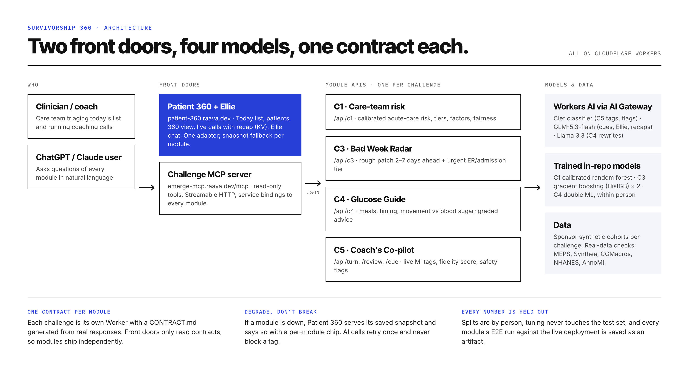
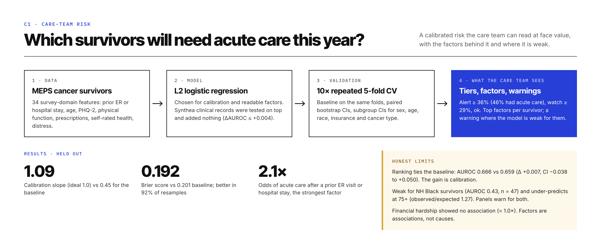
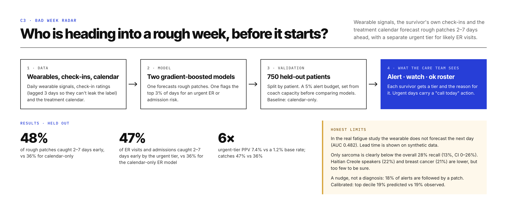
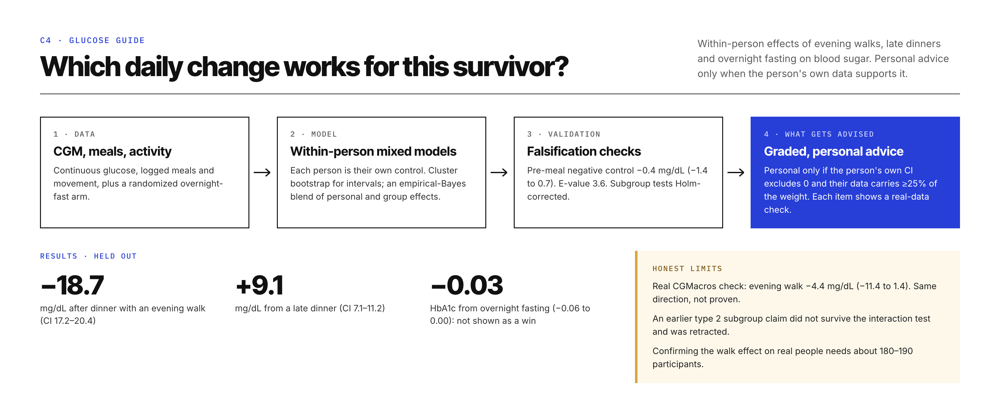
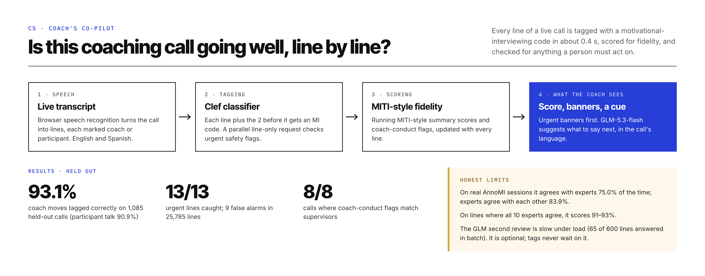

# Survivorship 360

eMerge Hackathon · Sylvester Comprehensive Cancer Center healthcare track · built in one day, everything custom.

**Survivorship 360 gives a cancer-survivorship care team one place to see who needs them today, and why.** It joins four AI modules, one per challenge, into a single clinician console with a chat assistant. An MCP server gives the same data to any AI assistant, such as ChatGPT or Claude.

- **Who needs a call today.** A wearable model warns of a rough week 2–7 days ahead. A separate urgent tier flags a likely ER visit or admission.
- **Who is at risk of acute care.** A calibrated risk model whose probabilities can be trusted at face value.
- **What to change in daily life.** Personal, evidence-graded advice on meals, timing and movement against blood sugar.
- **How the coaching is going.** Every line of a coaching call is scored live for motivational-interviewing fidelity, with banners for anything a person must act on.

Every number in the product traces to a validation run in its module's repo: held-out patients, out-of-fold cross-validation, or falsification checks. Each module states where it is weak (fairness gaps, real-data checks that do not confirm the synthetic effect) in the UI, not only in the README.

## Try it

| What | Live |
|---|---|
| **Patient 360**: clinician console + Ellie assistant | https://patient-360.raava.dev |
| C1 Care-team risk | https://c1-acute-risk.zay-259.workers.dev |
| C3 Bad Week Radar | https://c3-rough-patch.zay-259.workers.dev |
| C4 Glucose Guide | https://c4-glucose-guide.zay-259.workers.dev |
| C5 Coach's Co-pilot | https://coach.raava.dev |
| MCP server (ChatGPT / Claude) | `https://emerge-mcp.raava.dev/mcp` |

## Modules

| Module | Challenge | What it does | Headline result | Repo |
|---|---|---|---|---|
| Patient 360 | all | Clinician console: Today list, patients, per-patient 360 view, live coaching calls with recap, Ellie chat assistant. Owns the whole application layer. | Latest E2E against the deployed site: 81/83 (fails: a Workers AI rate limit in Ellie, one 502) | [`coach-console`](modules/coach-console) |
| C1 Care-team risk | C1 acute-care risk | Calibrated random forest on MEPS survivors, picked from 48 candidates; risk tiers, per-survivor drivers, fairness flags, red flags for the care team today | Out-of-fold: log loss 0.539 vs 0.606 baseline (significant); calibration slope 1.10 vs 0.45; AUROC 0.711 vs 0.672 (not significant) | [`c1-acute-risk`](modules/c1-acute-risk) |
| C3 Bad Week Radar | C3 wearables | Forecasts rough patches 2–7 days early from wearables, lagged check-ins and the treatment calendar; urgent ER/admission tier with a "call today" action | Held out, 5% alert budget: 48% of patches caught early vs 36% calendar-only; ER/admissions 36% vs 22% | [`c3-rough-patch`](modules/c3-rough-patch) |
| C4 Glucose Guide | C4 dose & timing | Double ML, within person: evening walks, late dinners and overnight fasting vs blood sugar; personal advice only when the person's own data supports it | Evening walk −18.3 mg/dL after dinner (CI 16.6–20.1); each claim tagged with a real-data check | [`c4-glucose-guide`](modules/c4-glucose-guide) |
| C5 Coach's Co-pilot | C5 coaching conversations | Tags every call line with an MI code in ~0.4 s (Cloudflare Clef), live fidelity score, safety banners, GLM coaching cues | Held out: 93.1% coach moves, 90.9% participant talk on 1,085 calls; 13/13 urgent lines caught | [`coach-copilot`](modules/coach-copilot) |
| Challenge MCP | all | 13 read-only tools over every module for ChatGPT and Claude, incl. "score this conversation" | E2E 67/67 with the official MCP client | [`challenge-mcp`](modules/challenge-mcp) |

Who owns what: the challenge modules are engines and APIs only (model, data pipeline, validation, `CONTRACT.md`). Patient 360 owns everything users see.

## Architecture



Each module is its own Cloudflare Worker with a small JSON contract (`CONTRACT.md` in each repo). Patient 360 and the MCP server consume only those contracts. Patient 360 falls back to a saved snapshot when a module is down.

## How each challenge works

Each panel shows the data, the model, how it was validated, what the user sees, the held-out results and the honest limits.

### C1 · Care-team risk



### C3 · Bad Week Radar



### C4 · Glucose Guide



### C5 · Coach's Co-pilot



Diagrams are made in Paper; the PNGs in `docs/` are exports.

## Honest limits

- The module cohorts are separate synthetic datasets supplied by the sponsors; they share no patient ids. Cross-module views use composite synthetic personas, labelled as such.
- C1 ranks better than its baseline, but not significantly (AUROC 0.711 vs 0.672); the proven gain is in its probabilities. It ranks NH Black survivors poorly (AUROC 0.48, n = 47), and the panel warns.
- C3's lead time is shown on synthetic data; in the real fatigue study the wearable does not forecast the next day (AUC 0.482). Recall is lower for Haitian Creole speakers (22% vs 31% Spanish), breast cancer (21%), sarcoma (13%) and Black patients (26% vs 29%).
- C4's real-data checks point the same way as the synthetic effects but do not prove them; the real walk effect is much smaller (−3.2 mg/dL, CI −6.9 to 0.5).
- C5 agrees with AnnoMI experts 75.0% of the time vs 83.9% expert-to-expert agreement (91–93% where all experts agree).

## Keeping this README true

`scripts/check-drift.sh` fails when this README no longer matches reality:
- a submodule pin is behind its repo's `main`, or a local module has unpushed commits;
- a live URL is down, or the MCP server's tool count changed;
- a headline number in `docs/claims.tsv` no longer appears in the module's own docs.

The coordinator runs it on a schedule and fixes the README, the diagrams and the pins when it fails.

## Repo layout

`modules/` holds each module as a git submodule. Clone with:

```sh
git clone --recurse-submodules <this repo>
```

| Module | GitHub |
|---|---|
| coach-console | https://github.com/zaycruz/coach-console |
| c1-acute-risk | https://github.com/zaycruz/c1-acute-risk |
| c3-rough-patch | https://github.com/zaycruz/c3-rough-patch |
| c4-glucose-guide | https://github.com/zaycruz/c4-glucose-guide |
| coach-copilot | https://github.com/zaycruz/coach-copilot |
| challenge-mcp | https://github.com/zaycruz/challenge-mcp |
