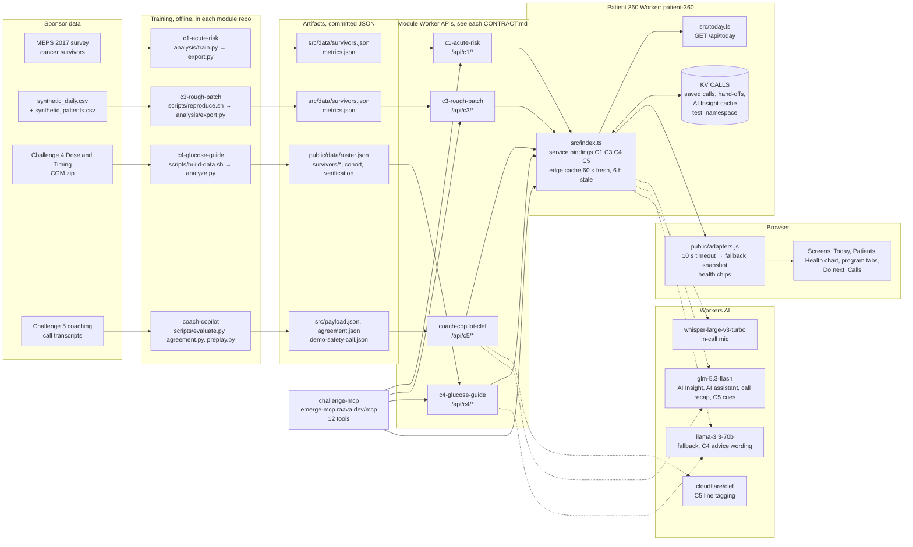

# How Patient 360 works

Patient 360 (https://patient-360.raava.dev) is one clinician record across four programs:
- C1: hospital risk, from real MEPS survey data.
- C3: rough weeks, from wearables.
- C4: glucose.
- C5: coaching calls.

Each program is its own repo and Cloudflare Worker with its own API. Patient 360 calls those APIs, puts one ranked queue on top, and adds AI Insight and an AI assistant. The MCP server is a second consumer of the same APIs.

Paths in this doc are relative to `survivorship-360/docs/`. Every endpoint listed here returned 200 from a live curl against `https://patient-360.raava.dev` on 2026-10-17 (production version `620a0347`).

## The data path

The MCP server binds C1, C3 and C4 directly. It reads C5 through the Patient 360 Worker (`/api/c5`).

## The modules

### C1 hospital risk ([`../modules/c1-acute-risk`](../modules/c1-acute-risk/README.md))

- **What it computes.** For 199 held-out real MEPS cancer survivors, it gives the chance of an ER visit or hospital stay next year. The model is a calibrated random forest on 16 survey features. Tiers: alert ≥43%, watch ≥29%.
- **Red flags.** `redFlags.careTeamToday` comes from survey answers: hopelessness, and serious psychological distress (K6).
- **No model runs at request time.** `analysis/features.py`, `train.py` (10×5 cross-validation), `explain.py` (TreeSHAP) and `export.py` write `src/data/survivors.json` and `metrics.json`.
- **Validation:**
  - "When the model we serve says a survivor's risk is 50% or more, it is right 59% of the time [46%, 71%]. The organisers' baseline is right 48%."
  - Nested-CV AUROC is 0.711 vs 0.672 for the baseline. The difference is +0.039 [−0.015, +0.091], not significant.
  - Log loss is 0.539 vs 0.606, which is significant. ([README](../modules/c1-acute-risk/README.md))
- **Endpoints:** `/api/c1/survivors`, `/api/c1/survivors/:id` (ids look like `c1-S71188550`), `/api/c1/metrics`.
- **Fields P360 reads:**
  - roster: `survivorId`, `displayName`, `status`, `headline`, `tags`, `updatedAt`.
  - detail: `risk`, `riskWords`, `caveat`, `forAssistant`, `redFlags.{careTeamToday, banner, fromSurvey[].{text,urgency}}`, `charts.risk.{value, baseRate, alertFrom, watchFrom}`, `charts.drivers[].logitContribution`, `recommendations[].{audience,text}`, `fairnessFlags`, `profile`.
  - metrics: `finalModel`, `metrics[*].auroc`, `data.devSurvivors`, fairness groups.
  - All are written in `analysis/export.py` (`main`, `red_flags`, `flag_fairness`). Tiers and fairness come from `analysis/train.py`.

### C3 rough weeks ([`../modules/c3-rough-patch`](../modules/c3-rough-patch/README.md))

- **What it computes.** For 60 synthetic wearable patients, as of 2025-01-31, it gives two numbers:
  - `risk`: the chance a rough patch starts within 7 days.
  - `urgentRisk`: the chance of an ER visit or hospital stay within 7 days.
  
  "Urgent" means the top 3% of days.
- **Where the numbers come from.** A gradient-boosted model reads watch signals against the patient's own usual range, plus the treatment calendar. `scripts/reproduce.sh` runs `analysis/train.py` and `real_check.py`, then `analysis/export.py`, which writes `src/data/survivors.json` and `metrics.json`.
- **Validation:**
  - 750 held-out patients; week AUC 0.827.
  - At a 5% alert budget it catches 48% of rough patches 2–7 days early. The calendar alone catches 36% (95% CI of the difference: +8 to +15 points).
  - Precision is 18% vs 11%. ([README](../modules/c3-rough-patch/README.md), "Results on held-out patients")
- **Endpoints:** `/api/c3/survivors`, `/api/c3/survivors/:id` (e.g. `c3-P03000`), `/api/c3/metrics`.
- **Fields P360 reads:**
  - `status`, `headline`, `urgent`, `urgentRisk`, `risk`, `thresholds.{alert, watch, urgent}`, `summary`, `evidence[]` (signal, label, riskShare), `recommendations[].{action, urgency}`, `profile.{language, context}`.
  - `charts.{dates, risk, urgentRisk, doseDays, watchWornHours, …}`.
  - These are computed in `analysis/export.py` (`describe`, `drivers`, `actions`, `schedule_context`).

### C4 glucose ([`../modules/c4-glucose-guide`](../modules/c4-glucose-guide/README.md))

- **What it computes.** For 50 synthetic CGM wearers, from the latest window (weeks 11–12, else weeks 1–2), it gives:
  - time in range (70–180), time below 70 and 54, time above 180 and 250;
  - the average, and GMI.
- **The care-team flag** (`scripts/analyze.py`, `care_flag`):
  - `urgency: "today"` if more than 1% of readings are below 54.
  - `"this-week"` if more than 4% are below 70, the average is above 250, or more than 5% are above 250.
  - Time in range under 70% alone goes to the next visit.
- **Advice cards** cite evidence ids. The Worker may reword a card with an AI model, but it keeps only wording whose numbers trace back to the evidence.
- **Validation:**
  - "In 44 real adults, a walk after a meal went with a sugar rise only 3.2 mg/dL smaller (95% CI −6.9 to +0.5): not distinguishable from zero."
  - "In the synthetic program, a walk after dinner shows −18.3 mg/dL." ([README](../modules/c4-glucose-guide/README.md))
- **Endpoints:** `/api/c4/survivors`, `/api/c4/survivors/:id` (e.g. `c4-N0072`), `/api/c4/survivors/:id/advice`, `/api/c4/cohort`, `/api/c4/verification`.
- **Fields P360 reads:**
  - roster: `careTeamToday`, `todayReason`, `priority`, `careTeamUrgency`.
  - `careTeamFlag.{today, urgency, reasons[].{reason, evidenceId}, rule}`.
  - `evidence[]` ids `tir`, `mean_glucose`, `tbr70`, `tar180`, `tar250`, `late_share`, `fast_avg`, with `label`, `value`, `unit`, `ci`, `scope`.
  - `hypoglycaemiaWarning`, `recommendations[]`, `charts.{dailyProfile, dinnerResponse, walkResponse, walkDose, overnightFast, checkups}`, `patientView.{en, es, ht}`.
  - Everything comes from `scripts/analyze.py`, except `patientView`, which comes from `scripts/patient_copy.py`. Advice wording comes from `src/index.ts` `advice()`.

### C5 coaching calls ([`../modules/coach-copilot`](../modules/coach-copilot/README.md), Worker `coach-copilot-clef`)

- **Tagging (Clef, `@cf/cloudflare/clef`).** A coach line gets one of 12 motivational-interviewing coach moves; a participant line gets change, sustain or neutral talk. Lines can also be flagged: medical, distress, social, dropout, missed concern, medical advice.
- **Deterministic parts.** The call score (`scripts/score.py`; `scoreParts` in `src/c5.ts`), the cue triggers, and the red-flag phrase list `src/redflags.json` (English, Spanish, Kreyòl).
- **GLM parts.** GLM writes the review text (for lines tagged with confidence below 0.3) and the coaching cue. Both are cached in KV for 7 days.
- **Validation:**
  - "Coach move tags: 93.1% correct (12 labels, 1,085 calls)".
  - "Urgent lines caught: 13 / 13". After the distress definition was widened to suicide warning signs, false alarms are 244 in 25,785 lines (9 before), and every distress flag carries "Use your suicide-risk screening protocol now."
  - The call score agrees with supervisors at r = 0.75 and 0.70. Two supervisors agree with each other at 0.69.
  - On an independent hard-case set written and committed before its run (v4), it catches 139/162 urgent lines and 44/54 suicide warning signs (25/54 before the widening).
  - Haitian Creole is tested on the safety flag only. ([README](../modules/coach-copilot/README.md))
- **Endpoints:** `/api/c5/survivors`, `/api/c5/survivors/:id` (e.g. `c5-P0002`), `/api/c5/calls`, `/api/c5/calls/:callId`, `/api/c5/demo`, `/api/c5/agreement`, `POST /api/c5/turn`. A 429 carries `retry-after: 20`.
- **Fields P360 reads:**
  - survivor: `status`, `headline`, `charts.calls[].{callNumber, date, score, flags[]}`, `evidence[]` with kind `flag-*`, `recommendations[].{action, why, urgency}`.
  - call: `callId`, `date`, `language`, `coach`, `participantName`, `score`, `scoreParts`, `flags[].{line, t, kind, text}`, `lines[]`.
  - `/demo`: `banners[].{level, flag, quote}`, `playedAt`.
  - `/agreement`: correlations, `mae`, `supervisorIcc`.
  - All computed in `src/c5.ts`.

### MCP server ([`../modules/challenge-mcp`](../modules/challenge-mcp/README.md))

- **Where it runs.** `https://emerge-mcp.raava.dev/mcp`. `/health` returns version 0.4.4.
- **12 default tools** (plus `reveal_outcome_demo`, only on `?tools=demo`): `triage_today`, `list_survivors`, `get_survivor`, `patient_overview`, `module_metrics`, `glucose_advice`, `list_coaching_calls`, `get_coaching_call`, `score_conversation`, `coaching_cue`, `search`, `fetch`.
- **Which tools call a model:**
  - `score_conversation` uses Clef, through C5 `/api/turn`.
  - `coaching_cue` uses GLM, with a rule fallback.
  - `glucose_advice` uses Llama through C4, only when there is no precomputed wording.
- **Auth.** Open by design. An optional `MCP_KEYS` bearer is supported. Rate limits apply only to the three tools that call a live model: 20 requests/min per IP, 60/min per key.

## Field to screen

`adapters.js` is the only client file that knows the module shapes; `app.js` only renders what it returns. The P360 Worker passes module JSON through as is (`/api/c1/*` → C1, and so on), except `/api/today`, which it builds itself.

### Tiering: what makes "Call today" vs "This week"

`/api/today` (`../modules/coach-console/src/today.ts`) is the only tier rule. Patients, the header pill and the AI assistant reuse its "today" ids through `actToday()` and `oneTier()` in `adapters.js`, cached 60 s. So every screen shows the same tier.

| Program | Call today (`horizon: "today"`) | This week (`horizon: "week"`) | Rank within tier |
|---|---|---|---|
| C5 | Every coaching call with a medical or distress line, whatever its age. A flag under 30 days old is a hand-off; an older one carries "Close the loop" and ranks 60 lower. The Clef demo call replayed today (`/api/c5/demo` red banner) counts as today. | A social-need line (rank 450) | fresh: medical 960, distress 950; older ("Close the loop"): 900, 890 |
| C3 | `urgent === true` (or a headline starting "Urgent"): 7-day ER/hospital risk over the urgent line | Other `status: "alert"` rows (rough week ahead) | today 940 + urgentRisk; week 400 + risk |
| C1 | `redFlags.careTeamToday === true` (survey red flag), whatever the tier | Alert tier, highest next-year risk, top 5 | today 910; week 500 + risk |
| C4 | `careTeamFlag.urgency === "today"` (more than 1% of readings below 54) | Every other care-team flag or alert. Without `urgency`, all C4 rows are This week. | lows 830 + %below 70; highs 820; others 300 + (100 − TIR) |

Rows sort Call today first, then by rank. `interpreter` is true when the patient's language is not English.

Live on 2026-10-17 (16:10 EDT): 39 rows.
- Call today 19: C1 9, C5 8, C3 2.
- This week 20: C4 11, C1 5, C3 3, C5 1.

Every live C4 flag is currently `"this-week"`.

### Today (`#today`, `renderToday` in `app.js`)

| Screen element | Adapter | Endpoint and field | Computed in |
|---|---|---|---|
| "Call today" count | `today()` | `/api/today` rows where `horizon === "today"` | `src/today.ts` (rules above) |
| "This week" count | `today()` | `/api/today` rows where `horizon === "week"` | `src/today.ts` |
| "Handed off today" | `context()` | `/api/handoffs` entries dated today | P360 KV `handoffs`, written by Escalate / Mark called |
| "All patients" (335) | `roster()` | length of the four `/survivors` lists (199 + 60 + 50 + 26) | each module's roster export |
| Row reason (C5) | `today()` | `reason` ← call `flags[0].{kind, text}`, call number, age ("replayed today", "12 days ago") | `today.ts` from C5 `src/c5.ts` flags |
| Row reason (C3) | `today()` | "ER/hospital risk N% in 7 days, day X of cycle Y" ← `urgentRisk`, `profile.context` | C3 `analysis/export.py` |
| Row reason (C1) | `today()` | "Red flag (age/sex cancer): answers" ← `redFlags.fromSurvey[].text`, `profile`; week rows show "ER/hospital risk N% next year, visits" | C1 `analysis/export.py` `red_flags()` |
| Row reason (C4) | `today()` | roster `todayReason` | C4 `scripts/analyze.py` |
| Data chip (Real · MEPS / Synthetic) | `today()` | `data` | `today.ts`, fixed per program |
| Language / Interpreter chip | `today()` | `language`, `interpreter` ← C3 `profile.language`, C5 call `language` | module exports |
| Only the top 8 shown | — | `TODAY_MAX = 8` in `app.js`; the rest are on Patients | — |

### Patients (`#patients`)

| Screen element | Adapter | Endpoint and field | Computed in |
|---|---|---|---|
| Name, program, status | `roster()` → `rosterRow()` | each `/survivors` list: `displayName`, `status`, `headline`, `tags`, `updatedAt` | module exports |
| Act today / Watch tier | `oneTier(row, actToday())` | `/api/today` today ids | `src/today.ts` |
| Fresh concern / hand-off note | `overlay()` | `/api/calls`, `/api/handoffs` (P360 KV) | P360 Worker |

### Health chart tiles (`#p-<id>`, one tile per program; `#p-x-L*` linked demo records show all four)

| Tile | Adapter | Number ← field | Status word ← rule | Computed in |
|---|---|---|---|---|
| C1 "Next-year ER or hospital risk (from 2017 survey)" | `c1View` hero | `risk` (or `charts.risk.value`) | "Act today" if `redFlags.careTeamToday`; otherwise High/Middle/Low tier from `charts.risk.alertFrom` (43%) and `watchFrom` (29%). Compare line: `baseRate`. | C1 `export.py`, `train.py` `tiers_from_oof` |
| C3 "7-day ER or hospital risk" (urgent) or "7-day rough-week risk" | `c3View` hero | `urgentRisk` or `risk`; sparkline `charts.urgentRisk` / `charts.risk` (last 14 days) | Urgent → "Act today"; otherwise above/near/below `thresholds.alert` / `watch`. "About N× their usual" is taken from `headline`. | C3 `export.py` |
| C4 trigger metric (when flagged), else "Time in range (70–180 mg/dL)" | `c4View` hero | the evidence item named by `careTeamFlag.reasons[0].evidenceId` (e.g. `tbr70` 10.3%), else evidence `tir`. Bar: `tbr70`, `tir`, `tar180 − tar250`, `tar250`. | Flagged → "Alert", target from the reason text. Otherwise TIR ≥70 on target, ≥90 ideal, <10 far off. | C4 `analyze.py` |
| C5 "Flagged lines" (when any) or "Last call score" | `c5View` hero | count of `flags[]` across `charts.calls`, or the latest `score` /100 | "Act today: flagged line" if the flagged call is under 30 days old, otherwise "Review" / "Close the loop". Score: ≥60 on target. | C5 `src/c5.ts`; age rule in `adapters.js` |
| Header pill (Act today) | `patient()` | `oneTier` against `/api/today` | — | `src/today.ts` |

### Program tabs and Do next

| Element | Adapter | Field | Computed in |
|---|---|---|---|
| C1 "What drives it" bars | `c1View` | `charts.drivers[].logitContribution` | C1 `explain.py` (TreeSHAP) |
| C1 red-flag banner | `c1View` `top` | `redFlags.banner` | C1 `export.py` `red_flags()` |
| C1 fairness note | `c1View` `fit` | `fairnessFlags`, metrics fairness groups | C1 `train.py` `fairness()` |
| C3 "What drives it" bars, health-monitor rows | `c3View` | `evidence[].riskShare`, `charts.*` vs the personal usual band | C3 `export.py` `drivers` |
| C4 "Send to the care team today / this week" banner | `c4View` `ctf` → `app.js` | `careTeamFlag.urgency` (`"today"` → today, `"this-week"` → this week), `reasons[].reason` | C4 `analyze.py` `care_flag` |
| C4 advice cards | `advice(id)` | `/api/c4/survivors/:id/advice` `items[].{title, text, source}` | C4 `src/index.ts` `advice()` |
| C4 low-sugar warning | `c4View` | `hypoglycaemiaWarning.{level, text, translations}` | C4 `analyze.py` |
| C5 calls list, score chart | `c5View` | `charts.calls[].{callNumber, score, flags}` | C5 `src/c5.ts` |
| Do next steps 1–4 | `doNext` / `firstStep` in `app.js` | each tile's `todo`: C1 `recommendations` (care-team), C3 `recommendations[0].action` (fever/fluids → "Hand off to the nurse today"), C4 urgency text, C5 flag age text | module recommendations; wording in `adapters.js` |

### Calls (`#calls`, call detail `#call-<id>`)

| Element | Adapter | Endpoint and field | Computed in |
|---|---|---|---|
| Call rows | `calls()` | `/api/c5/calls`: `callId`, `date`, `coach`, `participantName`, `score`, `flags`, `language` | C5 `src/c5.ts` |
| "Logged in Patient 360" rows | `context()` | `/api/calls` (P360 KV `calls:index`, test rows removed) | P360 Worker |
| Flagged lines in red | `call(id)` | `/api/c5/calls/:id` `flags[].{line, t, kind, text}`, `lines[]` | C5 `src/c5.ts` |
| Supervisor agreement | — | `/api/c5/agreement` correlations, `mae`, `supervisorIcc` | C5 `scripts/agreement.py` → `src/agreement.json` |
| Live call tags | `call.js` | `POST /api/c5/turn` (Clef) | C5 Worker |

## What is AI and what is fixed

| Output | How | Model |
|---|---|---|
| Every number, status, tier and queue row | Deterministic: module exports plus `today.ts` rules | none |
| AI Insight (one sentence on the Health chart, labelled "AI · check before acting") | Workers AI, JSON schema, retried once; cached in KV under `insight2:<id>:<hash of the patient data>` | `@cf/zai-org/glm-5.3-flash` |
| AI assistant (`POST /api/assistant`): find patients, explain, open pages, start calls | Tool-calling turn over the roster | GLM; after one retry on a rate limit, `@cf/meta/llama-3.3-70b-instruct-fp8-fast` |
| AI assistant red flags: fever, chest pain or breathlessness, swollen leg, fall, hopelessness or self-harm | **Fixed answer from a regex list (`RED_FLAGS` in `src/index.ts`), no model call.** The response has `model: "rules"`. | none |
| C5 line tags and safety flags | Clef | `@cf/cloudflare/clef` |
| C5 review text and coaching cue | GLM, cached 7 days; the cue triggers are rules | `glm-5.3-flash` |
| C4 advice wording | Optional rewording, kept only if its numbers match the evidence | Llama 3.3 70B |
| In-call mic transcript | `POST /api/stt` | `@cf/openai/whisper-large-v3-turbo` |
| Call recap (`POST /api/recap`: summary, where to pick up, open concerns) | JSON schema from the last saved call | GLM, Llama fallback |

## When something fails

- **Module slow or down (browser).** `fetchJSON` in `adapters.js` aborts after 10 s. It then uses `window.SNAPSHOT` (`public/fallback-data.js`, rebuilt by `scripts/snapshot.mjs`). Missing required fields are filled from the same saved copy (`fillMissing`).
- **Status chips.** Each program's top-bar chip reads "live", "fallback" (saved copy in use) or "down". `health[mod]` drives them through the `p360:health` event.
- **Module error (Worker).** The response is 502 with "This program is not answering right now. Try again in a minute." `/api/today` lists programs that returned nothing in `failed` and builds the queue from the rest.
- **Edge cache.** Module GETs are cached at the edge. A copy is fresh for 60 s. After that it is served stale and refreshed in the background, for up to 6 h (`x-p360-cache: miss | hit | stale`).
- **Rate limits.**
  - GLM is retried once after 1.2 s, then the Llama fallback is used.
  - If both fail, the AI assistant answers from the roster without a model, or says "The AI assistant is busy" (503). The client retries once.
  - C5 `POST` turn, review and cue are retried twice on 429, with a 700 ms × attempt backoff plus jitter.
  - If AI Insight fails, the Health chart shows the program headline instead.
- **Test traffic.** A request with cookie `p360test=1` or header `x-p360-test: 1` reads and writes only `test:`-prefixed KV keys, and every record it writes is stamped `test: true`. Normal reads drop test records, so E2E runs never show on the live screens.

## Checks

- **P360 E2E.** `e2e/live.mjs` runs against the deployed site with real module data. The run on production `620a0347` passed 110 of 114 checks: `../modules/coach-console/runs/2026-10-17T20-41-26/manifest.json`. The 4 misses are one phone-width layout bug (the single-program overview scrolls sideways at 390 px); the console is desktop-only, and every desktop check passes.
- **Module checks.** Each module's README states its validation and how to reproduce it (links above).
